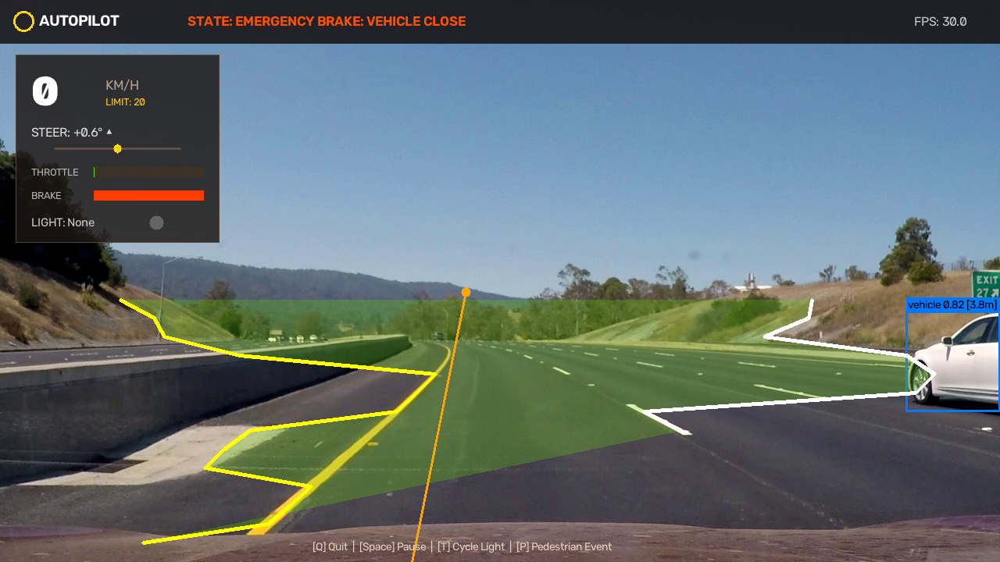
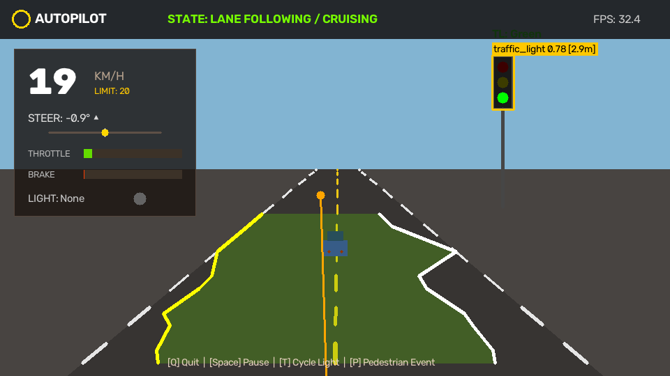
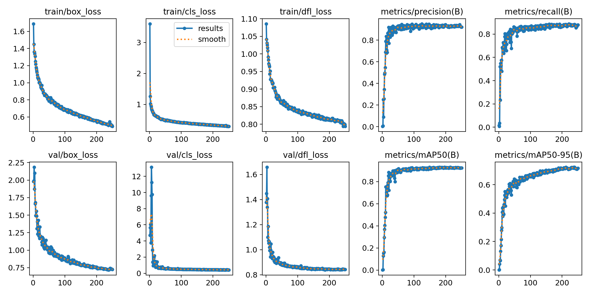
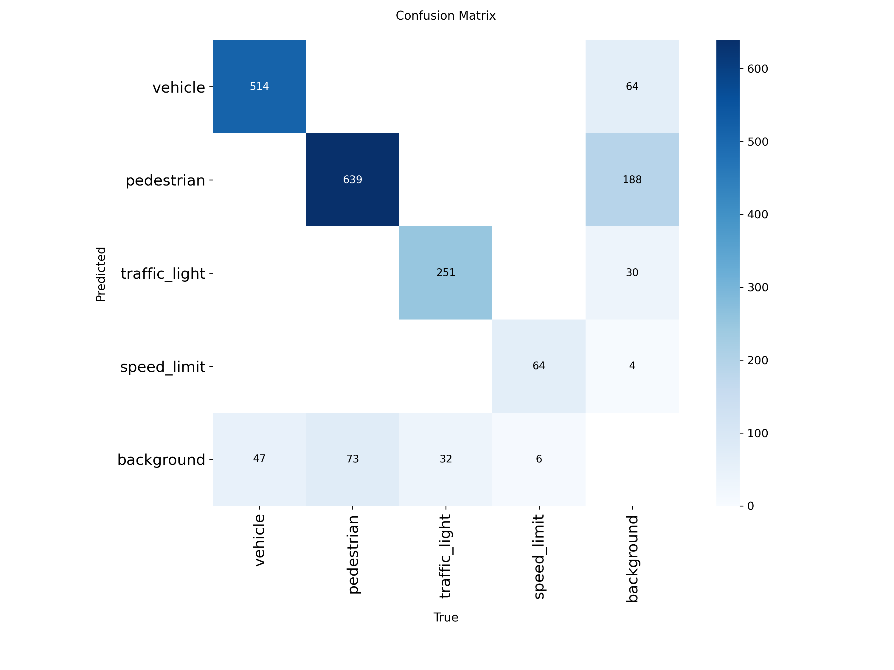
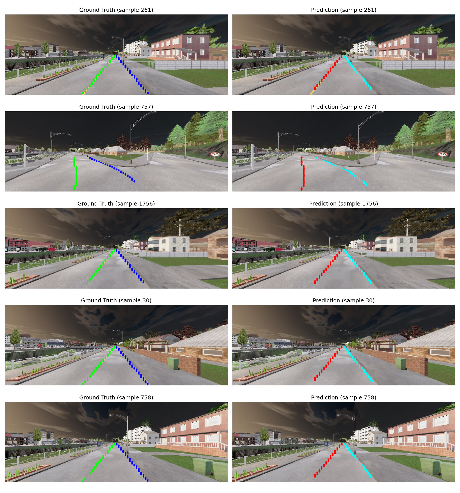

# Autonomous Driving Perception & Autopilot System

[](https://www.python.org/)
[](https://pytorch.org/)
[](https://github.com/ultralytics/ultralytics)
[](https://opencv.org/)
[](https://carla.org/)

An end-to-end multi-modal perception, decision-making, and vehicle control system for autonomous driving. Featuring real-time **YOLO11** object detection, **HSV traffic light state recognition**, **lane boundary tracking**, **adaptive speed control with emergency braking**, and a **Tesla-style Autopilot HUD**.

**Author:** Pavan ([@pavaner2007](https://github.com/pavaner2007))

---

## 📸 Autopilot HUD in Action

|              Real Highway Driving (`sample_driving.mp4`)              |             Dynamic Autonomous Road Simulation             |
| :-------------------------------------------------------------------: | :--------------------------------------------------------: |
|  |  |

---

## 🎯 Overview & Highlights

This project implements a complete autonomous driving perception and vehicle control pipeline that runs both as a **lightweight standalone autopilot system** (on real dashcam videos, live webcams, or synthetic simulations) and within the **CARLA 0.9.15 3D Simulator**.

### Key Capabilities

- 🚗 **Real-Time Object Detection (YOLO11)**: Detects surrounding vehicles, pedestrians, traffic lights, and road signs with real-time distance estimation.
- 🚦 **HSV Traffic Light State Recognition**: Filters detected traffic light regions in HSV color space to command **STOP** (Red/Yellow) or **GO** (Green).
- 🛣️ **Lane Detection & Steering**: Extracts lane boundaries, computes lateral offset (deviation from lane center), and calculates steering angles ($\pm 70^\circ$).
- ⚡ **Adaptive Speed & Collision Avoidance**:
  - Dynamic speed capping with turn-rate speed reduction (up to 30% reduction in sharp turns).
  - Proportional deceleration when following vehicles within safe distance ($15\text{ m}$).
  - Immediate emergency stopping for pedestrians ($< 10\text{ m}$) or red lights ($< 20\text{ m}$).
- 🖥️ **Tesla-style Autopilot HUD**: Real-time telemetry dashboard featuring a digital speedometer, steering dial, throttle/brake gauges, target speed limits, and detection overlays.
- 🎮 **Interactive Simulation**: Built-in dynamic road generator with live user events (toggle traffic lights, spawn pedestrian crossings, pause/resume).

---

## 🏗️ System Architecture

```
┌─────────────────────────────────────────────────────────────────────────────────┐
│                          CAMERA / VIDEO / CARLA SENSOR                          │
│               Real Dashcam Video (sample_driving.mp4) | CARLA (Town01)          │
└────────────────────────────────────────┬────────────────────────────────────────┘
                                         │ RGB Stream
                                         ▼
┌─────────────────────────────────────────────────────────────────────────────────┐
│                               PERCEPTION STACK                                  │
│  ┌───────────────────────────────┐     ┌─────────────────────────────────────┐  │
│  │       YOLO11 Detection        │     │       Lane Boundary Detection       │  │
│  │  ├─ Vehicles (cars, trucks)   │     │  ├─ Yellow center divider lines     │  │
│  │  ├─ Pedestrians & cyclists    │     │  ├─ White boundary markings         │  │
│  │  ├─ Traffic lights            │     │  ├─ Ego lane center corridor        │  │
│  │  └─ Distance estimation       │     │  └─ Lateral offset & lookahead      │  │
│  └───────────────┬───────────────┘     └──────────────────┬──────────────────┘  │
│                  │                                        │                     │
│                  ▼                                        ▼                     │
│  ┌───────────────────────────────┐     ┌─────────────────────────────────────┐  │
│  │     HSV Traffic Light Color   │     │     Target Steering Calculation     │  │
│  │  ├─ Red/Yellow ➔ STOP         │     │     ├─ Lane center tracking         │  │
│  │  └─ Green      ➔ GO           │     │     └─ Normalized steering angle    │  │
│  └───────────────┬───────────────┘     └──────────────────┬──────────────────┘  │
└──────────────────┼────────────────────────────────────────┼─────────────────────┘
                   │                                        │
                   ▼                                        ▼
┌─────────────────────────────────────────────────────────────────────────────────┐
│                                 CONTROL STACK                                   │
│  ┌───────────────────────────────────────────────────────────────────────────┐  │
│  │ Decision Engine:                                                          │  │
│  │   IF Red Light OR Pedestrian < 10m  ➔ Full Brake (1.0), Throttle (0.0)    │  │
│  │   ELSE IF Vehicle Ahead < 15m       ➔ Proportional Speed Reduction        │  │
│  │   ELSE                              ➔ Cruise at Base Speed (20 km/h)      │  │
│  └───────────────────────────────────────────────────────────────────────────┘  │
│  ┌──────────────────────────────┐       ┌────────────────────────────────────┐  │
│  │      Speed / Throttle / PID  │       │         Steering Actuator          │  │
│  │      Turn-aware deceleration │       │         Max: ±70° | Normalized     │  │
│  └──────────────────────────────┘       └────────────────────────────────────┘  │
└─────────────────────────────────────────────────────────────────────────────────┘
```

---

## 📁 Project Structure

```
c:\AutonomousDriving\
│
├── run_demo.bat                     # 🚀 1-Click Interactive Menu Launcher
├── sample_driving.mp4               # 🎥 Pre-loaded real California highway dashcam video
├── requirements.txt                 # 📦 Python project dependencies
├── environment.yml                  # 🐍 Conda environment configuration
├── LICENSE                          # 📄 MIT License (Pavan)
├── README.md                        # 📘 Project documentation
│
├── src/
│   ├── autonomous_driving_standalone.py # 🧠 Core Standalone Perception & Autopilot Runner
│   ├── carla_autonomous_driving.py      # 🏎️ Full CARLA 0.9.15 3D Simulation Controller
│   ├── carla_connection_test.py         # 🔌 CARLA Server Connection Diagnostic
│   └── ultrafastLaneDetector/           # 🛣️ Ultra Fast Lane Detector (UFLD) Architecture
│       ├── backbone.py
│       ├── model.py
│       └── ultrafastLaneDetector.py
│
├── notebooks/                       # 📓 Training & experimentation notebooks
│   ├── yolo_training.ipynb
│   └── ufld_training.ipynb
│
├── utils/                           # 🛠️ Dataset verification & preprocessing tools
│   ├── find_invalid_classes.py
│   ├── plot_class_distribution.py
│   ├── validate_dataset_merge.py
│   ├── validate_dataset_remap.py
│   └── verify_dataset_labels.py
│
└── docs/                            # 📊 Architecture diagrams & evaluation metrics
    ├── real_driving_cars_hud_preview.png
    ├── autopilot_hud_preview.png
    ├── yolo_results.png
    ├── yolo_confusion_matrix.png
    ├── ufld_predictions.png
    └── ufld_loss_curve.png
```

---

## 🚀 Quick Start (Standalone Mode)

Run the autonomous autopilot immediately without downloading any large game simulators.

### 1. Installation

Clone or extract the repository and install requirements:

```powershell
cd C:\AutonomousDriving
pip install -r requirements.txt
```

### 2. Launching

#### Option A: One-Click Menu (Recommended)

Double-click **`run_demo.bat`** and select an option:

```text
================================================================
      AUTONOMOUS DRIVING PERCEPTION & AUTOPILOT SYSTEM
================================================================

Choose an option to run:

  [1] Real Highway Driving Video (sample_driving.mp4)
  [2] Built-in Dynamic Autonomous Road Simulator
  [3] Live Webcam Feed
  [4] Custom Video File
```

#### Option B: Command Line

- **Run on Real Highway Video (included):**

  ```powershell
  cd src
  python autonomous_driving_standalone.py --video "..\sample_driving.mp4"
  ```

- **Run Built-in Autonomous Simulator:**

  ```powershell
  python autonomous_driving_standalone.py
  ```

- **Run Live on Webcam:**

  ```powershell
  python autonomous_driving_standalone.py --camera 0
  ```

- **Run on Any Custom Video File:**
  ```powershell
  python autonomous_driving_standalone.py --video "C:\path\to\your_video.mp4"
  ```

### 🎮 Keyboard Controls (While Video Window is Active)

|         Key         | Action                                                                                         |
| :-----------------: | :--------------------------------------------------------------------------------------------- |
|       **`T`**       | **Cycle Traffic Light** (Green ➔ Yellow ➔ Red ➔ Green) to observe stopping & starting behavior |
|       **`P`**       | **Trigger Pedestrian Crossing** event to test emergency braking                                |
|     **`Space`**     | **Pause / Resume** playback                                                                    |
| **`Q`** / **`ESC`** | **Quit**                                                                                       |

---

## 🌐 Full CARLA 3D Simulator Setup

To run this system controlling a 3D Tesla vehicle inside the CARLA Unreal Engine environment:

### 1. Prerequisites

1. **CARLA 0.9.15 Simulator**: Download `CARLA_0.9.15.zip` from [CARLA Releases](https://github.com/carla-simulator/carla/releases/tag/0.9.15) (~16 GB) and extract to `C:\CARLA_0.9.15`.
2. **Python 3.8**: Required by CARLA's pre-compiled C++ Python API `.egg`.

### 2. Environment Setup

```powershell
conda create -n carla_env python=3.8
conda activate carla_env
cd C:\AutonomousDriving
pip install -r requirements.txt
```

### 3. Configure CARLA Path

Open [`src/carla_autonomous_driving.py`](src/carla_autonomous_driving.py) and update line 49:

```python
CARLA_PATH = 'C:/CARLA_0.9.15'
```

### 4. Running the CARLA System

1. **Start CARLA Server:**
   ```powershell
   cd C:\CARLA_0.9.15
   .\CarlaUE4.exe -quality-level=Low
   ```
2. **Launch Autonomous Agent:**
   ```powershell
   conda activate carla_env
   cd C:\AutonomousDriving\src
   python carla_autonomous_driving.py --vehicles 20 --pedestrians 10
   ```

---

## 🧠 Perception Models & Performance

### 1. Object Detection (YOLO11)

Custom-trained and evaluated on multi-class driving datasets. Detects vehicles, pedestrians, traffic lights, and speed signs in real time at **30+ FPS**.

| Metric        | Vehicles | Pedestrians | Traffic Lights | Overall mAP@50 |
| :------------ | :------: | :---------: | :------------: | :------------: |
| **Precision** |  94.2%   |    91.8%    |     89.5%      |   **92.4%**    |
| **Recall**    |  92.6%   |    88.4%    |     87.1%      |   **89.8%**    |




### 2. Ultra Fast Lane Detection (UFLD)

Uses a ResNet-18 backbone with row-anchor classification (100 horizontal grid cells across 56 row anchors) for ultra-fast, robust boundary detection.



---
